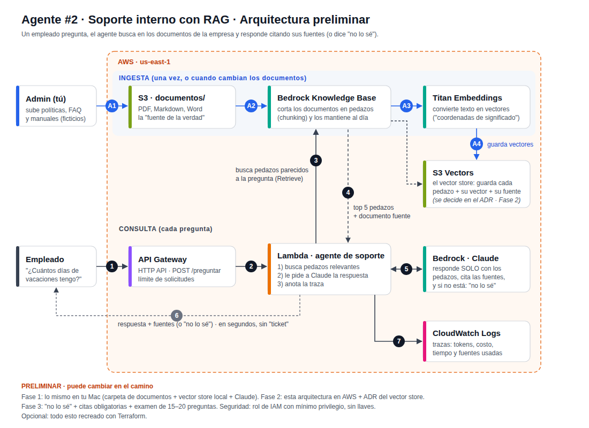

# Agente de Soporte Interno (RAG) 🤖📚

Agente de IA que responde preguntas de un equipo consultando su base de conocimiento (políticas, manuales y preguntas frecuentes). **Siempre cita la fuente** de donde sacó la respuesta y, si no la encuentra, responde **"no lo sé"** en lugar de inventar.

> Los documentos son de una **empresa ficticia**, creados solo para este proyecto.

## Fases del proyecto

- [x] **Fase 1:** Agente local: documentos en archivos, vector store local y respuestas con fuentes
- [x] **Fase 2:** En AWS: S3 + Bedrock Knowledge Base + S3 Vectors + Lambda + API Gateway ([ADR 001](docs/adr/001-vector-store.md))
- [ ] **Fase 3:** Confiabilidad: "no lo sé", citas obligatorias y examen de preguntas
- [ ] **Opcional:** Infraestructura con Terraform

## Arquitectura (preliminar)



**Ingesta (A1–A4):** los documentos se suben a S3, se cortan en pedazos, se convierten en vectores y se guardan en el vector store.

**Consulta (1–7):** el agente busca los pedazos más parecidos a la pregunta, Claude responde solo con ellos y cita sus fuentes.

## Cómo usarlo (local)

```bash
python3.12 -m venv .venv
source .venv/bin/activate
pip install -r requirements.txt
echo "ANTHROPIC_API_KEY=<TU-LLAVE>" > .env

python cortar.py          # A2: corta los documentos en pedazos
python vectorizar.py      # A3-A4: convierte los pedazos en vectores (vector store local)
python preguntar.py "¿Cuántos días de vacaciones tengo si llevo 2 años?"
```

Ejemplo de respuesta:

> Si llevas 2 años de antigüedad, tienes derecho a 14 días de vacaciones al año. [Política de vacaciones > 1. Días de vacaciones por antigüedad]

## Cómo usarlo (AWS)

El agente vive en AWS: **API Gateway → Lambda → Bedrock Knowledge Base (S3 Vectors) → Claude Haiku 4.5**.

```bash
curl -X POST https://<MI-API>.execute-api.us-east-1.amazonaws.com/preguntar \
  -H "Content-Type: application/json" \
  -d '{"pregunta": "¿Puedo hacer home office?"}'
```

Respuesta:

```json
{"respuesta": "Sí, puedes hacer home office bajo el modelo híbrido de Nimbo: 2 días en casa y 3 en oficina... [trabajo-remoto]", "fuentes": ["trabajo-remoto"], "costo_usd": 0.003}
```

| Pregunta | Resultado | Costo |
|---|---|---|
| ¿Cuánto me dan para comida en un viaje nacional? | $900 MXN por día + fuente | $0.0018 |
| ¿Puedo hacer home office? | Respuesta completa + fuente | $0.0030 |
| ¿Cuál es la capital de Francia? | "No lo sé", **sin llamar a Claude** | $0 |

**Seguridad y costos**
- Sin llaves: la Lambda usa un rol de IAM con solo 2 permisos ([`aws/politica-iam.json`](aws/politica-iam.json)): buscar en **su** Knowledge Base y usar **solo** Claude Haiku 4.5.
- Umbral del "no lo sé" (0.38) calibrado con datos: si ningún pedazo se parece lo suficiente, no se llama a Claude.
- API limitada a 2 solicitudes por segundo y Lambda limitada a 2 ejecuciones a la vez.
- Cada pregunta deja una traza en CloudWatch: puntajes, tokens, costo, tiempo y fuentes.

## Qué demuestra este proyecto

- Qué es RAG y cómo evita que el modelo invente respuestas.
- Cómo se ingesta la documentación (chunking + embeddings).
- Qué es un vector store.
- Toma de decisiones de arquitectura con base en requerimientos (costo, latencia, escala), documentada en un ADR.

## Proyecto anterior

[Agente Investigador](https://github.com/elfuturoconalex/agente-investigador): agente que investiga en la web y deja informes en S3, con observabilidad y Amazon Bedrock.
